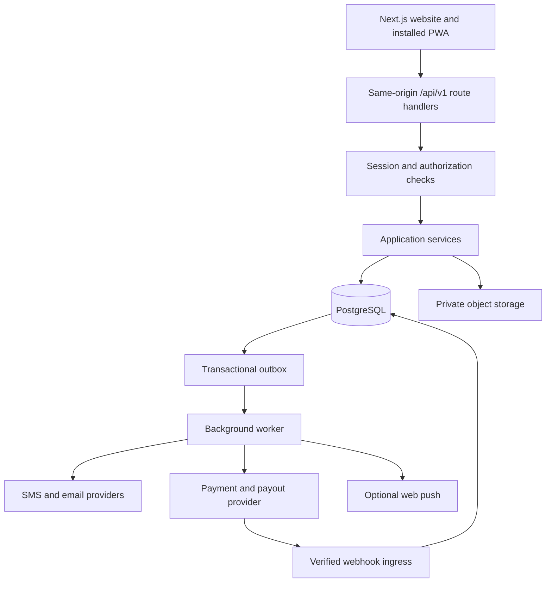
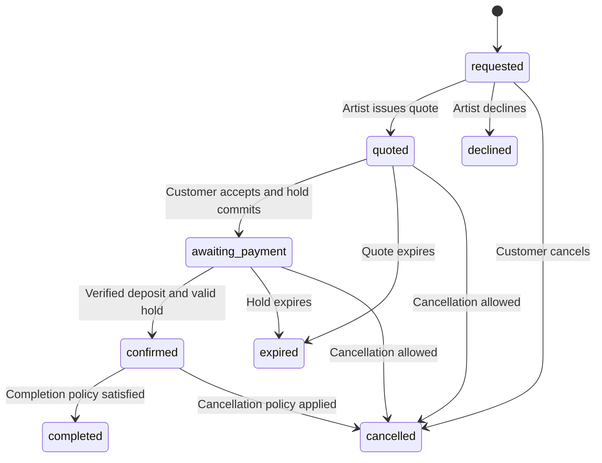

# IND64 API Architecture

Version: 1.0 | Date: 10 October 2026 | Status: Proposed, not implemented

## 1. Purpose and Scope

Define the backend required to turn the existing IND64 Next.js marketplace into a production application for customers, artists, and administrators. Scope includes mobile OTP authentication, artist discovery and onboarding, shortlists, availability, event bookings, messaging, payment collection, payouts, notifications, and PWA integration.

This is an implementation blueprint, not an assertion that these services already exist. Payment, SMS, storage, and deployment providers remain to be selected. Fees, cancellation rules, deposit percentages, settlement timing, and verification requirements need business approval before implementation.

## 2. Current Application

| Area | Current behavior | Production requirement |
| --- | --- | --- |
| Frontend | Next.js 15 App Router, React 19, TypeScript, atomic UI components | Retain existing component structure |
| Artist directory | `src/data/content.ts` provides static artists and categories | Published catalog API and database |
| Authentication | `AuthPreviewProvider.tsx` uses browser session storage and a fixed preview OTP | Server-issued OTP challenges and revocable sessions |
| Inquiry | `BookingButton.tsx` downloads a text file; no request is sent | Persisted inquiry and booking workflow |
| Dashboards | Sample bookings, requests, earnings, and notifications | Ownership-scoped API queries |
| Saved artists | `ind64-shortlist` in local storage | Authenticated, cross-device shortlist |
| Request decisions and availability | Device-local state in `DashboardView.tsx` | Transactional server state |
| Messaging | Locally saved drafts; messages are not delivered | Conversation membership and persisted delivery |
| PWA | Manifest, installation UI, production service worker, offline fallback | Keep authenticated data out of service-worker caches |

Existing dashboard URLs are presentation routes, not API endpoints. The preview role switch is not an authorization mechanism. The registration UI's `organiser` value maps to the canonical API role `customer`.

## 3. Target Architecture

Start with one modular backend within the existing Next.js project. Route handlers expose HTTP contracts, application services enforce business rules, repositories access PostgreSQL, and a separately running worker processes durable asynchronous jobs. Splitting into independent services is not required for the initial release.



| Module | Responsibility |
| --- | --- |
| Identity | OTP challenges, sessions, profile, account roles |
| Catalog | Categories, locations, published artist profiles, packages, search |
| Artist management | Applications, moderation, media, profile editing |
| Scheduling | Availability blocks, temporary holds, confirmed reservations |
| Booking | Event requirements, quotes, decisions, cancellations, completion |
| Conversations | Participant membership, message persistence, read markers |
| Money | Payment orders, ledger, refunds, settlement eligibility, payouts |
| Notifications | In-app feed, preferences, delivery jobs |
| Operations | Moderation, audit trail, reconciliation, reporting |

Suggested source layout:

```text
src/app/api/v1/                 HTTP adapters
src/server/auth/                Session and permission helpers
src/server/modules/<domain>/    Schemas, services, repositories
src/server/db/                  Database client and migrations
src/server/providers/           SMS, payment, storage adapters
src/server/jobs/                Job handlers and outbox dispatcher
src/server/observability/       Structured logging and metrics
workers/                       Background worker entry point
docs/openapi.yaml              Future machine-readable API contract
```

Server Components may call application services directly; browser components use the HTTP API. Both entry points must execute the same authentication and authorization rules. Mark server modules server-only and never expose provider secrets to client bundles.

## 4. API Conventions

- Base path: `/api/v1`; HTTPS in production; JSON request and response bodies.
- Opaque UUID resource identifiers. Public artist slugs are lookup aliases, not ownership evidence.
- Timestamps: ISO 8601 UTC. Scheduling inputs also include an IANA timezone, initially `Asia/Kolkata`.
- Event intervals use `[startsAt, endsAt)`; include setup and teardown in reservation intervals.
- Money: integer minor units plus currency, e.g. `{ "amountMinor": 8500000, "currency": "INR" }` represents INR 85,000. Never use floating-point amounts.
- Lists: opaque cursor pagination, stable ordering with an ID tie-breaker, default limit 20, maximum 100. Bind cursors to filters and ordering.
- Validation failures use field-level errors; unknown writable fields are rejected.
- Sensitive responses use `Cache-Control: private, no-store`. Public catalog responses may use short shared-cache lifetimes with explicit invalidation on publication changes.
- Client-supplied IDs never replace ownership checks. Hide inaccessible private resources with `404` where existence disclosure is unnecessary.
- Document contracts in OpenAPI before each module is integrated. Version breaking changes; additive optional fields can remain in v1.

Success envelope:

```json
{
  "data": [{ "id": "artist_uuid", "name": "Ananya Krishnan" }],
  "meta": { "nextCursor": null },
  "requestId": "req_uuid"
}
```

Error envelope:

```json
{
  "error": {
    "code": "AVAILABILITY_CONFLICT",
    "message": "The artist is no longer available for this time.",
    "fields": []
  },
  "requestId": "req_uuid"
}
```

Use `200` for reads/updates, `201` for resource creation, `202` for accepted asynchronous work, and `204` for successful bodyless removal. Errors: `400` malformed input, `401` missing/expired session, `403` forbidden operation, `404` unavailable resource, `409` state/version conflict, `422` domain validation, `429` throttled, and `503` temporary dependency failure. Never return raw provider errors or stack traces.

Mutating booking decisions, payment creation, refunds, and payout initiation accept `Idempotency-Key`. Persist a unique actor/operation/key record with a request-body hash and result; an identical replay returns the stored outcome, a different payload returns `409`. Serialize concurrent first attempts. Keep payment-provider idempotency identifiers and ledger uniqueness constraints beyond the API replay window.

## 5. Identity and Permissions

Use opaque, revocable server sessions in a `Secure`, `HttpOnly`, `SameSite=Lax`, `Path=/` cookie such as `__Host-ind64-session`. Store only a hash of the token server-side. Rotate sessions after authentication and privilege changes. Proposed defaults: 7-day idle expiry and 30-day absolute expiry, configurable by environment. Logout revokes the server record and clears the cookie.

For state-changing browser requests, validate Origin and a session-bound CSRF token. Do not enable wildcard credentialed CORS. Webhooks use provider signature verification rather than cookie/CSRF authentication.

| Actor | Permissions |
| --- | --- |
| Visitor | Read published catalog; request/verify an OTP |
| Customer | Own profile, shortlist, bookings, conversations, payments, notifications |
| Artist | Own artist profile, packages, availability, assigned booking requests, conversations, payouts |
| Administrator | Moderation and controlled support operations with audited access |
| Worker/provider | Narrow service capabilities; no general user session |

Users may have both customer and artist membership. A UI role switch changes the view only. Artist permissions require approved artist membership linked to the user. Registration cannot grant administrative privileges or bypass artist approval. Require stronger authentication for administrators and sensitive payout-account changes.

### OTP Flow

1. Normalize the submitted phone into E.164 format. Initially support Indian mobile numbers; validate country support server-side.
2. Create an opaque challenge with purpose, expiry, resend eligibility, and attempt budget; queue provider delivery.
3. Store an HMAC of the code with a server secret, never plaintext. Do not log OTPs or full phone numbers.
4. Verify atomically: challenge purpose, expiry, remaining attempts, code match, and unused state.
5. Consume the challenge once, create/resolve the account, and establish the session. For a new account, collect registration fields before completing onboarding.
6. Return the authenticated user's memberships and onboarding state to determine the dashboard destination.

Proposed initial limits: five-minute expiry, five verification attempts per challenge, 60-second resend cooldown, and layered phone/IP/device hourly quotas. Resending invalidates the previous code; quota accounting survives challenge replacement. Use generic delivery responses to avoid revealing account existence. Provider failures return a retryable state without creating a session.

## 6. Data Model

All mutable entities have IDs, creation/update timestamps, and where needed a version column. Foreign keys and uniqueness constraints enforce relationships; application validation alone is insufficient.

| Entity | Important fields and constraints |
| --- | --- |
| User | Unique normalized phone; name; optional verified email; account status |
| Membership | User ID, role, approval state; unique user/role |
| Session | User ID, token hash, idle/absolute expiry, revoked timestamp |
| OtpChallenge | Phone hash/reference, code HMAC, purpose, expiry, attempts, consumed timestamp |
| ArtistProfile | Owner user ID, unique slug, name, bio, city ID, publication state |
| Category / ArtistCategory | Stable category slug; many-to-many artist/category relation |
| ArtistPackage | Artist ID, title, duration, capacity, fee minor units, currency, active flag |
| MediaAsset | Owner ID, storage key, type, scan state, public/private visibility |
| ShortlistItem | Unique customer ID/artist ID pair |
| AvailabilityBlock | Artist ID, start/end, timezone, reason; private details |
| Booking | Customer ID, artist ID, event interval, venue, occasion, brief, state, version |
| Quote | Booking ID, immutable version, line items, total, deposit, expiry, policy snapshot |
| Reservation | Artist ID, buffered interval, hold/confirmed/released state, hold expiry |
| Conversation / Participant | Booking-linked conversation; authorized user memberships |
| Message | Conversation ID, sender ID, body, client message ID; unique sender/client ID |
| Payment | Booking ID, provider order/reference, amount, currency, state |
| LedgerEntry | Immutable balanced financial entries grouped by transaction ID |
| Refund | Payment ID, provider reference, amount, reason, processing state |
| Payout | Artist ID, eligible ledger references, provider reference, state |
| Notification | Recipient ID, type, resource ID, read timestamp |
| PushSubscription | User ID, endpoint, subscription keys, revocation state |
| OutboxEvent / WebhookEvent | Unique event IDs, payload, processing state, retry metadata |
| AuditEvent | Actor, action, resource, redacted change summary, request ID, timestamp |

Index published artists by category/location, bookings by customer/date and artist/state/date, messages by conversation/created-at/ID, and payouts by artist/state. Add PostgreSQL search indexes only after defining searchable fields. Private documents stay in private storage and use short-lived authorized download URLs.

## 7. Endpoint Catalog

All routes below are relative to `/api/v1`. Owner/participant checks apply to every private resource, including nested routes.

### Authentication and Account

| Method | Path | Access and behavior |
| --- | --- | --- |
| POST | `/auth/otp/challenges` | Public, throttled; request challenge |
| POST | `/auth/otp/challenges/{id}/resend` | Public challenge context; enforce cooldown |
| POST | `/auth/otp/challenges/{id}/verify` | Consume OTP; issue session |
| GET | `/auth/session` | Return current user, roles, CSRF token, onboarding state |
| DELETE | `/auth/session` | Revoke current session |
| GET / PATCH | `/me` | Read/update own allowlisted profile fields |
| POST | `/me/phone-change` | Start separate re-verification; never direct phone PATCH |

### Catalog and Artist Management

| Method | Path | Access and behavior |
| --- | --- | --- |
| GET | `/categories` | Published categories and subdisciplines |
| GET | `/locations` | Supported cities and regions |
| GET | `/artists` | Public search: q, category, city, minPriceMinor, maxPriceMinor, sort, cursor |
| GET | `/artists/{slug}` | Public published profile, packages, approved media |
| GET | `/artists/{id}/availability` | Public coarse bookability; no client identities or reservation details |
| POST | `/artist-applications` | Authenticated application; pending review |
| GET | `/me/artist-application` | Own application state and feedback |
| GET / PATCH | `/me/artist-profile` | Own artist draft; changes follow publication policy |
| POST | `/me/artist-profile/submit` | Submit draft for review |
| GET / POST | `/me/artist-packages` | Own package list/create |
| PATCH / DELETE | `/me/artist-packages/{id}` | Update/archive own package; retain historical booking snapshots |
| POST | `/media/uploads` | Authorized upload intent; size/type limits and signed destination |
| POST | `/media/uploads/{id}/complete` | Verify stored object, scan and process before publication |
| GET / PUT / DELETE | `/me/shortlist/{artistId}` | Read membership, idempotently save/remove artist |
| GET | `/me/shortlist` | Paginated saved artists |

Public availability is advisory. Only a successfully committed reservation establishes a hold.

### Booking and Scheduling

| Method | Path | Access and behavior |
| --- | --- | --- |
| POST | `/bookings` | Customer creates request and conversation |
| GET | `/me/bookings` | Customer's bookings; status/date filters |
| GET | `/me/booking-requests` | Artist's assigned requests; status/date filters |
| GET | `/bookings/{id}` | Participant sees permitted booking detail |
| PATCH | `/bookings/{id}` | Customer edits allowed event fields before quote acceptance; version required |
| POST | `/bookings/{id}/quotes` | Assigned artist issues immutable priced quote |
| POST | `/bookings/{id}/quote-acceptance` | Customer accepts current quote; creates time-limited reservation |
| POST | `/bookings/{id}/decline` | Assigned artist declines pending request |
| POST | `/bookings/{id}/cancellation` | Participant requests cancellation; server computes policy result |
| POST | `/bookings/{id}/completion` | Record completion evidence/confirmation after event |
| GET / POST | `/me/availability-blocks` | Artist lists/creates private unavailable intervals |
| DELETE | `/me/availability-blocks/{id}` | Artist removes own manual block; cannot remove booking reservation |

### Messages, Dashboards, Notifications

| Method | Path | Access and behavior |
| --- | --- | --- |
| GET | `/me/dashboard?role=customer|artist` | Permission-scoped summary derived from source records |
| GET | `/me/conversations` | Membership-filtered list |
| GET / POST | `/conversations/{id}/messages` | Participant history/send; cursor pagination and client message ID |
| PUT | `/conversations/{id}/read-marker` | Monotonic last-read message marker |
| GET | `/me/notifications` | Own in-app notification feed |
| PATCH | `/me/notifications/{id}` | Mark own notification read |
| GET / PATCH | `/me/notification-preferences` | Channel preferences |
| POST | `/me/push-subscriptions` | Register subscription after explicit browser permission |
| DELETE | `/me/push-subscriptions/{id}` | Revoke own subscription |

Start messaging with paginated fetches and bounded polling while the conversation is visible. Add authenticated server-sent events later if necessary; reconnect must reconcile from a persisted cursor. A successful message POST means persisted, not necessarily delivered or read.

### Money and Administration

| Method | Path | Access and behavior |
| --- | --- | --- |
| POST | `/bookings/{id}/payment-orders` | Customer; server-priced provider order; idempotent |
| GET | `/bookings/{id}/payments` | Participant-safe payment history |
| GET | `/me/payouts` | Artist's payout history and status |
| POST | `/me/payout-account-sessions` | Strong re-authentication; provider-hosted account onboarding |
| POST | `/webhooks/payments/{provider}` | Provider signature, raw body verification, replay deduplication |
| GET | `/admin/artist-applications` | Administrator review queue |
| POST | `/admin/artist-applications/{id}/decision` | Audited approve/reject decision |
| POST | `/admin/bookings/{id}/refunds` | Authorized, policy-checked, idempotent refund |
| GET | `/admin/audit-events` | Restricted, paginated audit access |

Provider-specific webhook and payout-account contracts must be finalized after provider selection. Do not implement placeholder success responses for money operations.

## 8. Representative Contracts

Create an event request:

```http
POST /api/v1/bookings
Content-Type: application/json
Idempotency-Key: <random-client-generated-key>
X-CSRF-Token: <session-bound-token>
```

```json
{
  "artistId": "artist_uuid",
  "packageId": "package_uuid",
  "event": {
    "occasion": "wedding",
    "startsAt": "2026-11-12T14:00:00Z",
    "endsAt": "2026-11-12T16:00:00Z",
    "timezone": "Asia/Kolkata",
    "cityId": "chennai",
    "venue": "Venue to be confirmed",
    "guestCount": 150,
    "brief": "Carnatic fusion performance for a sangeet."
  }
}
```

```json
{
  "data": {
    "id": "booking_uuid",
    "status": "requested",
    "conversationId": "conversation_uuid",
    "version": 1
  },
  "requestId": "req_uuid"
}
```

Customer identity comes from the session. The server resolves the package's artist ownership and validates dates, duration, supported currency, publication status, and input lengths. Creating a request does not reserve the artist or charge the customer.

Accept a quote using `{ "quoteId": "quote_uuid", "expectedVersion": 3 }`. Return booking state, hold expiry, and the server-calculated amount due. Stale versions, expired quotes, conflicting reservations, or changed policies return `409` and require a fresh read.

Send a message using `{ "clientMessageId": "uuid", "body": "Could you share your technical rider?" }`. Return its server ID and persisted timestamp. Duplicate submissions return the original message. Cap body length and reject attachments until the upload/scanning workflow is implemented.

## 9. Booking and Financial State Machines



Quote revisions are immutable and supersede older quotes before acceptance. Changes to a confirmed event require an explicit amendment process; never silently overwrite the financial or schedule agreement.

Reservation safety:

1. Validate quote and lock the relevant booking/reservation scope in a transaction.
2. Release expired holds and reject overlap with active holds, confirmed bookings, or manual blocks.
3. Insert the buffered reservation with a database exclusion constraint or equivalent serialized conflict enforcement.
4. Commit booking change and outbox notification together.
5. A worker expires holds; the acceptance path also handles stale holds synchronously.

Manual availability-block writes must use the same conflict mechanism as booking reservations. Initial assumption: one artist profile has capacity for one simultaneous event. Ensembles with multiple independent teams require an explicit resource/capacity model before selling concurrent dates.

Payment state is separate from booking state: `created -> pending -> captured | failed`, with refunds tracked separately as `requested -> processing -> succeeded | failed`. A cancellation may be final while its refund is still processing. Never infer refund completion from booking cancellation.

Webhook handling must verify signature and timestamp using raw bytes, insert a uniquely keyed durable event, then acknowledge promptly. Processing validates provider order ownership, amount, currency, and allowed transitions. Duplicate/out-of-order events cannot regress final state or create duplicate ledger entries. A browser checkout return never confirms payment by itself.

If capture arrives after hold expiry, attempt reservation re-acquisition atomically. If unavailable, record captured funds and initiate a refund/exception workflow; do not confirm the booking. Reconcile ambiguous provider responses by querying the provider with the original idempotency reference.

Payout state: `eligible -> queued -> processing -> paid | failed`. Eligibility depends on event completion, verified payout account, provider settlement, cancellation/dispute holds, and approved platform policy. Ledger entries, not UI totals, determine balances. Reserve eligible funds transactionally to prevent duplicate payouts. Never store raw card data or fabricate transfer success.

## 10. Background Work and Reliability

Use a transactional outbox for booking notifications, delivery requests, and financial follow-up work. Workers claim jobs with leases, retry transient failures with exponential backoff and jitter, and route exhausted jobs to a visible failure queue. Handlers must tolerate at-least-once execution.

Scheduled jobs cover OTP cleanup, quote/hold expiry, payment reconciliation, payout reconciliation, event reminders, and retention cleanup. Provider delivery status is stored independently from the business transaction. An SMS failure cannot roll back a confirmed booking.

Operational metrics include OTP delivery/verification failure rate, API latency/error rate, booking conflict count, webhook backlog age, unreconciled money records, failed payouts, and job retries. Use request IDs across HTTP, outbox, provider calls, and audit records. Redact phone numbers, OTPs, message bodies, session tokens, and payout credentials from logs.

## 11. Security and Data Handling

- Validate authenticated ownership in repositories/services, including message participants and payout owners.
- Use parameterized queries and allowlisted update schemas; no mass assignment of roles, totals, owner IDs, or financial states.
- Throttle OTP, search, message sending, upload creation, and booking submission independently.
- Keep storage private until files pass size, content-type, and malware checks. Generate object keys server-side.
- Encrypt traffic and managed data stores; keep provider credentials in server-side secret configuration.
- Audit moderation, money movement, permission changes, and support access. Restrict and monitor administrative tools.
- Define retention and account deletion procedures before launch. Preserve required financial records under a separately approved retention policy; do not invent legal retention durations.
- Back up the database with point-in-time recovery and run restore drills. Define recovery targets with the business.

## 12. PWA and Frontend Integration

Continue caching only the offline fallback and approved static assets. Do not cache OTP responses, dashboard responses, conversations, signed document links, or payments. The initial PWA requires connectivity for all mutations; do not silently queue bookings or payments offline.

| Existing UI | API integration |
| --- | --- |
| Login / register / verify OTP | Challenge endpoints and real session; remove preview-code path |
| Header and dashboard role switch | `/auth/session` and approved memberships |
| Browse, categories, artist profile | Catalog endpoints, server filters, loading/error/empty states |
| SaveArtist | `/me/shortlist`; offer an explicit merge of anonymous local saves after login |
| BookingButton | Create booking; display persisted request ID and actual status |
| ApplicationForm | Submit artist application; show review state |
| Customer bookings | `/me/bookings` and participant booking details |
| Artist requests | Assigned requests, quote submission, decline workflow |
| Availability calendar | Interval CRUD; show conflict feedback and booking-reserved dates |
| Message drafts | Keep optional local drafts, send through conversation API, clear only after acknowledgement |
| Payouts and statistics | Server-derived ledger summaries and payout history |
| Notifications | Authenticated feed; push only after explicit consent |

Use a shared typed HTTP client for credentials, error envelopes, cancellation, and request IDs. Invalidate affected queries after mutations. A `401` redirects to login with an allowlisted relative return path; a `409` refreshes stale state and explains the conflict. Do not show optimistic success for bookings, payments, or payouts.

## 13. Delivery Plan and Acceptance Criteria

1. **Foundation:** PostgreSQL migrations, validation, error contracts, sessions, OTP adapter, CSRF and authorization. Verify expiry, replay prevention, throttling, logout, and role escalation rejection.
2. **Catalog and onboarding:** Import reviewed seed data, artist application/moderation, packages, media, shortlist. Verify drafts are private and users cannot edit another artist.
3. **Booking and scheduling:** Requests, quotes, reservations, cancellation rules, dashboard summaries. Verify concurrent acceptance cannot double-book and retries cannot duplicate requests.
4. **Conversations and notifications:** Membership checks, idempotent sends, read markers, outbox jobs. Verify reconnect pagination and cross-conversation access denial.
5. **Money:** Provider sandbox, signed webhooks, ledger, refunds, payouts, reconciliation. Verify duplicate/reordered webhooks, late capture, partial refund, and provider timeout recovery before enabling live payments.
6. **Launch readiness:** Replace all sample UI data, test customer/artist journeys, validate PWA offline/reconnect behavior, exercise restore and reconciliation procedures, confirm monitoring and business policies.

Testing layers: service unit tests for lifecycle rules; PostgreSQL integration tests for transactions and concurrency; contract tests for documented schemas; browser tests for complete role-specific journeys; provider sandbox tests for money/SMS integrations. Use a fake clock for OTP, quote, and hold expiry tests.

## 14. Decisions Still Required

| Decision | Why it matters |
| --- | --- |
| SMS provider and supported countries | Delivery callbacks, sender setup, throttling and phone validation |
| Payment/payout provider and settlement model | Order, refund, verification, webhook and payout contracts |
| Platform commission, deposit and cancellation policy | Quote calculation, refunds and artist balances |
| Artist approval and identity checks | Publication and payout eligibility |
| Booking duration, travel/setup buffers and team capacity | Reservation conflict rules |
| Hosting, database and worker runtime | Durable jobs, backups, monitoring and scale |
| Storage provider and upload limits | Signed uploads, scanning and retention |
| Completion/dispute rules and support authority | Payout release and exception handling |

No deployment, provider purchase, database migration, or production API implementation is performed by this document.
